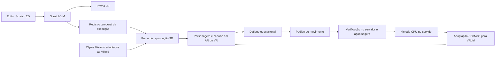

# Ponte de execução Scratch → VRoid

20/10/2026 — contrato técnico e primeira implementação local.
A ponte está em `site/src/scratchEngine.ts`, `trace.ts` e `World.ts`.
O estado validado e as limitações estão em [PARECER.md](PARECER.md).

## Objetivo confirmado

O aluno seleciona personagem/cenário e programa na interface web 2D.
O personagem padrão do VRoid deve executar, na apresentação 3D, o resultado
do programa criado no Scratch. AR e VR usam essa mesma reprodução.
Ao final, abre-se o diálogo educacional.

## Fluxo proposto

A Scratch VM conserva a responsabilidade por eventos, repetições, condições,
variáveis e ordem das ações. A ponte recebe os estados e eventos efetivamente
produzidos pela execução, com tempos, identificação do ator e do cenário.
Isso permite reproduzir em XR o resultado que o aluno já viu, inclusive
quando houve sorteio ou interação por teclado/mouse.

O registro precisa incluir eventos discretos e sua ordem, além de
deslocamentos ao longo do tempo. Apenas amostrar o estado uma vez por quadro
pode perder operações consecutivas ocorridas no mesmo quadro.

## Separar lógica e animação corporal

- **Estado lógico:** posição, direção, tempo, visibilidade, texto, cenário e
  demais efeitos suportados. A execução do Scratch determina esses valores.
- **Apresentação corporal:** caminhada, repouso e gestos adaptados ao
  esqueleto do VRoid. Os clipes complementam a apresentação sem mudar a
  posição final ou o tempo do programa.
- Nos deslocamentos controlados pela ponte, usar clipes de locomoção sem
  avanço horizontal próprio (*in-place*) para não deslocar o ator duas vezes.
- A reprodução no palco 3D usa coordenadas locais. A escala e a posição do
  diorama AR são aplicadas ao conjunto, preservando a relação entre ações.
- Definir explicitamente o plano do palco: por exemplo, X/Y do Scratch
  correspondendo ao plano de chão X/Z. A orientação da prévia deve tornar
  essa correspondência compreensível; Y não deve alternar silenciosamente
  entre altura e profundidade.

## Exemplos de correspondência

| Bloco ou comportamento | Resultado em 3D |
| --- | --- |
| Mova N passos | Aplicar o deslocamento correspondente na direção do ator |
| Vá para X/Y | Reposicionar o ator no ponto correspondente |
| Deslize por T segundos até X/Y | Interpolar até o destino em T segundos; usar caminhada quando adequada |
| Gire N graus | Alterar a direção pelo ângulo correspondente |
| Espere T segundos | Preservar o estado durante T segundos; pode tocar repouso corporal |
| Repita N vezes | Reproduzir o resultado das N execuções decididas pela VM |
| Mostre / esconda | Atualizar a visibilidade |
| Diga texto por T segundos | Apresentar texto pelo intervalo programado; voz exige política própria de sincronização |
| Troque o cenário | Usar a cena 3D associada ao identificador do cenário 2D |

“Mova”, “vá para” e “gire” não têm duração própria no Scratch. A ponte
não deve inserir uma caminhada de dois segundos em uma operação instantânea.
Para trajetos visíveis, os exemplos didáticos podem usar “deslize” ou uma
sequência de pequenos movimentos com esperas. Qualquer modo de reprodução
lenta precisa ser explícito e preservar a ordem e as proporções temporais.

Fantasias, efeitos gráficos, camadas, bordas e sensores requerem regras
específicas. O editor pode conservar sua base completa, mas a cobertura de
reprodução XR deve ser declarada; blocos ainda sem correspondência não
devem ser ignorados silenciosamente.

## Animações

**Primeira opção: Mixamo + transformações controladas pelo programa.**
Selecionar um acervo pequeno e adequado às atividades, começando por repouso
e caminhada. Corrida e gestos entram quando as atividades realmente precisarem.
Saltar, acenar ou dançar só devem ser executados quando houver uma ação
programada correspondente; não são efeitos implícitos de qualquer bloco.

Adaptar os clipes aos três personagens padrão do VRoid durante a preparação
do conteúdo. Conferir escala, orientação, braços/mãos, pés no chão,
deslocamento da raiz e transições. A reutilização do retargeting existente
não pressupõe usar os personagens que deram origem a esse código.

**Kimodo: complemento do acervo e movimento no diálogo final.**
O projeto da NVIDIA gera movimentos a partir de texto e restrições de pose
e trajetória. Se faltar uma ação, gerar um clipe durante a produção,
adaptá-lo ao VRoid, revisar e incorporá-lo ao mesmo acervo.
Não tornar a geração uma dependência de cada execução do aluno.

No encerramento, `site/src/server.ts` recebe o pedido, classifica a intenção
e seleciona um prompt fixo seguro de `motionPolicy.ts`. Somente esse prompt
alimenta Kimodo. Pedidos inadequados recebem “Vou fazer algo melhor”, sem
confirmação adicional. Falhas são explicadas e usam um aceno pronto.
`generatedMotion.ts` adapta o resultado SOMA30 ao bind do VRoid.
A instalação atual é `D:/kimodo`, CPU, checkpoint SOMA RP v1.1 e texto Q8_0.
WebGPU foi descartado pelo usuário: geração no servidor, reprodução no site.

A integração local existente usa `kimodo.cpp` e um checkpoint SOMA específico;
ela precisa ser conferida antes de trocar por modelos ou formatos novos.
Há registro local de falha em Vulkan na Radeon integrada e geração funcional
em CPU. Esse histórico descreve esta instalação, não o desempenho geral do Kimodo.

## Bases locais identificadas

- `src/core/utils/BoneRemap.ts`: seleção dos caminhos de adaptação.
- `src/core/retarget/retarget-ctr.ts` e `src/core/retarget/README.md`:
  caminho de retargeting compartilhado com suporte documentado ao VRoid.
- `src/core/anim/kimodoMotion.ts`: conversão SOMA30 para esqueleto e
  `AnimationClip` com convenções Mixamo.
- `vite-plugins/kimodoPlugin.ts`: geração e catálogo de movimentos locais.
- `apps/chared/src/sidebar/persona/KimodoPanel.tsx`: interface de autoria.
- `tools/kimodo/README.md`: histórico de compatibilidade local.

## Critérios para a primeira validação

1. Um personagem VRoid padrão e um cenário, vistos em 2D e 3D.
2. Um programa com iniciar, deslizar, girar, esperar e repetir, preservando
   ordem, posição final e duração da prévia.
3. Repetir a apresentação reinicia o estado corretamente.
4. Movimentos instantâneos mantêm sua semântica; o clipe de caminhada não
   adiciona deslocamento próprio ao trajeto.
5. Reproduzir uma execução com aleatoriedade/entrada gravada conserva o
   resultado; trocar português/inglês não muda o comportamento.
6. Definir encerramento: programas finitos terminam; “sempre” exige parada
   explícita ou limite anunciado para permitir a etapa de diálogo.
7. Conferir o mesmo resultado na tela, no Cardboard e no headset escolhido.

## Fontes consultadas

- [Scratch: implementação dos blocos de movimento](https://github.com/scratchfoundation/scratch-editor/blob/develop/packages/scratch-vm/src/blocks/scratch3_motion.js)
- [NVIDIA: Kimodo](https://research.nvidia.com/labs/sil/projects/kimodo/)
